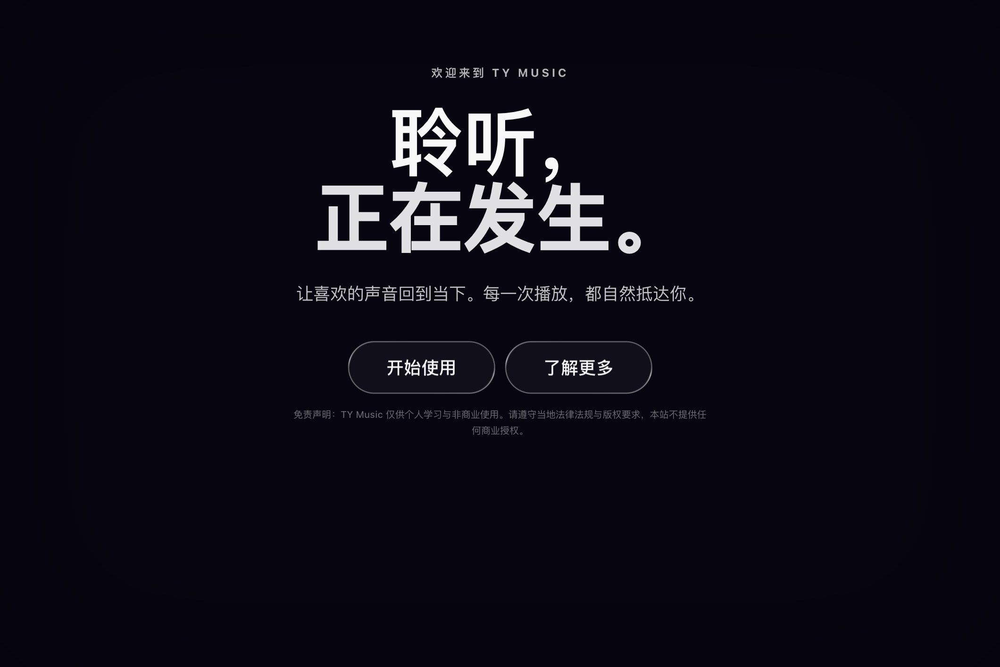

# TY Music

在浏览器或桌面听歌：搜索歌曲、浏览音乐分类、看全屏歌词，也能整理收藏、歌单和本地音乐。

**[打开网页播放器](https://ty-music.pages.dev/)** · **[下载 Mac / Windows 客户端](https://github.com/1981016893fty-pixel/ty-music/releases/latest)**

[](https://ty-music.pages.dev/)

## 开始听歌

手机打开首页直接进入轻量播放器，可搜索、播放、管理队列和喜欢歌曲。点底部歌曲区进入全屏：左边是专辑封面，右边是实时歌词，背景取自封面颜色。桌面版点「开始使用」进入完整版，可以浏览分类、导入本地音频和管理专辑、歌单。

桌面网页与客户端共用原有播放器界面。首页流动光线、全屏封面取色波纹等动效随页面启动，离开后停止。歌曲喜欢后，心形和按钮底色会变红；专辑收藏后则显示青色书签和青色底色。

搜索优先用 Embeat；等待较久时可以先显示网易云。Embeat 一旦成功，便整批替换网易云，即使它返回空结果也是如此。在线曲目和封面依赖外部服务，部分搜得到的歌曲可能没有可播放音频。

## 桌面客户端下载

从 [GitHub Releases](https://github.com/1981016893fty-pixel/ty-music/releases/latest) 的 Assets 选择：

| 系统 | 下载 | 安装 |
| --- | --- | --- |
| macOS 12+，Apple Silicon（M 系列） | `aarch64.dmg` | 打开 DMG，把 TY Music 拖入「应用程序」 |
| Windows 10/11，64 位 | `x64-setup.exe` 或 `x64_en-US.msi` | 日常安装用 EXE；有 MSI 部署需求时选 MSI |

客户端用 Tauri 封装同一套播放器界面。签名、构建和验收说明见[桌面指南](DESKTOP-GUIDE.md)。

## 在本地运行

需要 Node.js 22。克隆后在仓库根目录运行：

```sh
npm ci
npm start
```

打开 <http://localhost:8899>。桌面浏览器可用 <http://localhost:8899/mobile> 直接预览移动版。端口占用时用 `PORT=18899 npm start`。可选配置、健康检查和排障见[部署指南](DEPLOY-GUIDE.md)。

```sh
npm test
npm run test:genre
npm run build:pages
```

线上使用 Cloudflare Pages 和同源 Workers API；桌面包使用同一正式 API。开发与维护入口：[工程维护](docs/maintenance.md) · [桌面构建与发布](DESKTOP-GUIDE.md) · [API 说明](README_API.md) · [工程质量审查](docs/quality-audit.md)。

## 数据与使用范围

收藏、歌单、最近播放保存在当前浏览器或客户端的本地存储；本地音频保存在 IndexedDB，无账号同步。换站点或清除数据前，请先通过「关于 → 个人曲库备份与迁移」导出个人曲库。

项目仅供个人学习与非商业使用。在线媒体由外部服务提供，本项目不授予其内容的使用或分发许可。仓库未声明软件开源许可证。
